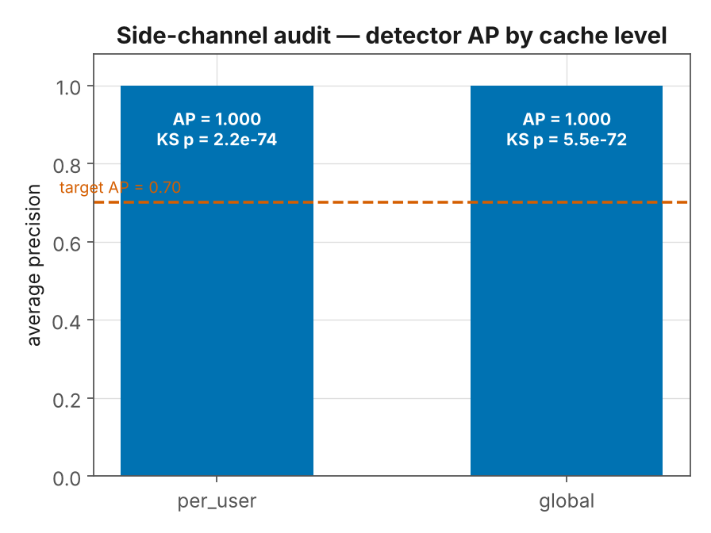
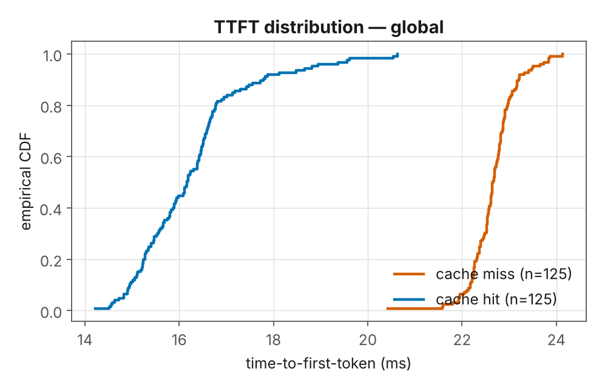
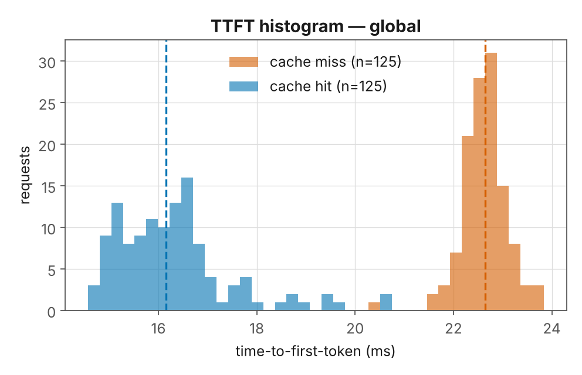
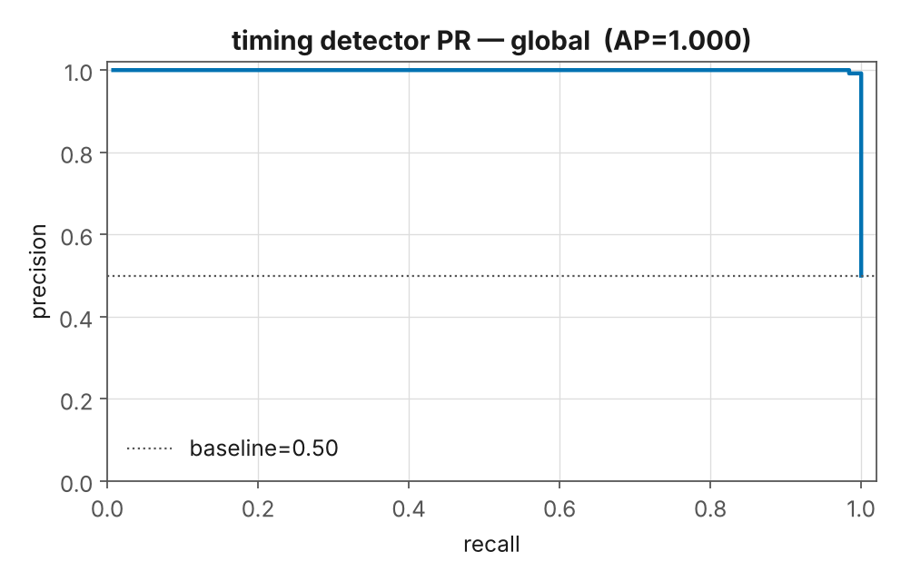

# Replication results — prompt-cache timing side channel on vLLM

**Run:** `runs/20261010-183945` · 2026-10-10 · white-box vLLM 0.9.3 on RX 7900 XTX (gfx1100), Docker/WSL2
**Model:** Qwen/Qwen2.5-0.5B-Instruct (ungated stand-in; Llama-3.1-8B pending HF access)
**Config:** `config/replication.yaml` · NUMSAMPLES=250/level · client TTFT · block_size=16 · prefix caching on

## Result: the side channel reproduces, with ground truth

| cache level | n | median miss | median hit | Δ TTFT | average precision | KS p |
|---|---|---|---|---|---|---|
| per_user | 250 | 22.51 ms | 15.88 ms | **+6.63 ms** | **1.000** | 2.2×10⁻⁷⁴ |
| global   | 250 | 22.65 ms | 16.16 ms | **+6.49 ms** | **1.000** | 5.5×10⁻⁷² |

Both levels **PASS** (KS p < 10⁻⁸ and AP ≥ 0.70). A cache hit is ~6.5 ms faster
than a miss — a gap far larger than the within-condition spread, so a single
TTFT measurement classifies hit vs miss almost perfectly.



## The distributions are cleanly separated
Hit and miss TTFT barely overlap — the ECDF curves don't touch.




Timing-detector precision-recall (global): AP ≈ 1.0 vs a 0.5 baseline.



(`per_user` figures are the matching `*_per_user.png` in the run's `figures/`.)

## What this replicates — and what it adds
- **Replicates (Gu et al.):** prompt caching is a timing side channel; same statistic
  (two-sample KS) and headline metric (average precision); the signal is strong.
- **Global sharing reproduced:** on stock vLLM the prefix cache is **process-global**
  (not partitioned by the OpenAI `user` field), so the `global` level — a hit for a
  prompt another "user" sent — passes. That is the paper's central real-world threat,
  here the **default** behavior.
- **Adds — ground truth:** every hit/miss label comes from vLLM's own
  `/metrics` prefix-cache counters, not inferred from timing. On hit trials the
  counters showed ~672/692 block hits; on miss trials, 0. So AP = 1.000 is a
  *measurement* against known labels, not a timing-inferred estimate — the thing a
  black-box audit cannot do.

## Caveats (honest scope)
- **Model is a stand-in.** Qwen-0.5B, not the paper's Llama-3.1-8B. The *method*
  replicates; exact magnitudes will shift with the real model. Swap `model.name` in
  `config/replication.yaml` once HF access lands — nothing else changes.
- **Local, not networked.** Client TTFT here excludes real network jitter, so the
  separation is cleaner than a remote attacker would see. The paper's point stands:
  even over a network the gap is detectable; locally it is stark.
- **Fast tiny model inflates clarity.** A 0.5B model prefills the ~160-token prefix
  quickly; the cache still saves a clean, repeatable ~6.5 ms. Larger models widen
  the absolute gap.
- **block_size=16** (ROCm V1): affects only recovery *granularity* (Exp 02/09), not
  detection.

## Reproduce
```bash
CACHELAB_CONFIG=/workspace/config/replication.yaml docker compose -f docker/docker-compose.rocm.yml up -d
bash scripts/run_replication.sh          # audit + figures into runs/<ts>/
```

## Next
1. Re-run on Llama-3.1-8B when access lands (same command).
2. **Exp 03 calibration** — AP vs cached-prefix length (adds the curve the paper couldn't).
3. **Exp 02/09 recovery** — block-granular prefix recovery (the attack they didn't build).
4. **Exp 04/06 defenses** — price salting / isolation against the TTFT gap.
